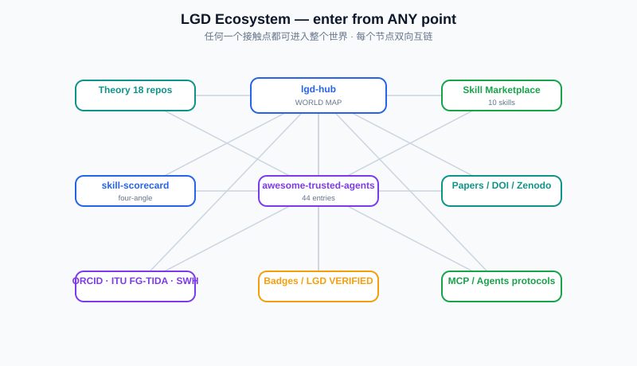
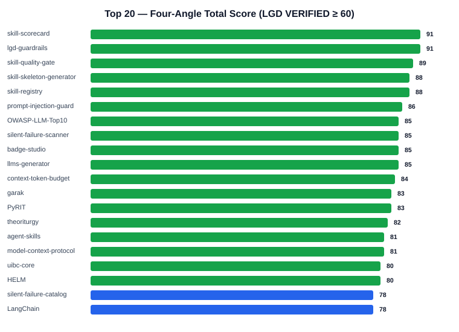

# 😎 awesome-trusted-agents

> **Trusted AI agent, skill, security, and benchmark list — every entry scored on four angles (REG/TRUST/SAFE/MACH).**
> **可信 AI 智能体 / 技能 / 安全 / 评测清单 —— 每一条目均经四角度评分（REG/TRUST/SAFE/MACH）。**

[](https://github.com/zhaoxinghua09-cell/awesome-trusted-agents) [](LICENSE) [](CONTRIBUTING.md)

## Ecosystem at a glance / 生态一目了然






## What is this? / 这是什么

English: A curated, **machine-readable and evidence-based** list of AI agent projects, agent skills, security & guardrail tools, and evaluation benchmarks. Unlike plain "awesome" lists, every entry carries a **Four-Angle Score** (REGISTERED / TRUSTWORTHY / SAFE / MACHINE-READABLE) produced by our open [skill-scorecard](https://github.com/zhaoxinghua09-cell/skill-scorecard) methodology, so you can trust what you adopt.

中文：一份**可机器读取、有证据依据**的 AI 智能体 / 技能 / 安全工具 / 评测基准精选清单。与普通 "awesome" 列表不同，每一条目都带有**四角度评分**（REGISTERED 注册度 / TRUSTWORTHY 可信度 / SAFE 安全度 / MACHINE-READABLE 机器可读度），由开源的 [skill-scorecard](https://github.com/zhaoxinghua09-cell/skill-scorecard) 方法论产出，让您可以放心选用。

**Current status / 当前状态**: 45 entries, 43 PASS · pilot scores based on public evidence, re-audit before final listing · 首批 45 条目，43 条通过；评分为公开资料初评，正式收录前逐条复核。

## Four-Angle Scoring / 四角度评分

| Angle | Meaning (EN) | 含义 (中文) | Threshold |
|---|---|---|---|
| REGISTERED | Identity, registry proof, namespace, attribution | 有籍：身份、登记证据、命名空间、署名 | ≥60 PASS |
| TRUSTWORTHY | Verification, evidence, reproducibility, citation | 有证：验证锚点、证据、可复现、引用 | ≥60 PASS |
| SAFE | Guardrails, least privilege, fail-closed, threat scan | 有门禁：护栏、最小权限、默认拒绝、威胁扫描 | ≥60 PASS |
| MACHINE-READABLE | Frontmatter, bilingual, license, index, hygiene | 基础设施：元数据、双语、许可、索引、规范 | ≥60 PASS |

**Total = equal-weighted mean of the four angles; PASS ≥ 60.** The scoring engine is open source — run it on any repo yourself:
**总分 = 四角度等权平均；PASS ≥ 60。** 评分引擎开源，您可自行对任意仓库运行：

```bash
python skill_scorecard.py <repo-or-skill-path> --json
```

## Contents / 目录

1. [LGD Theory Assets](#lgd-theory-assets)
2. [Agent Frameworks](#agent-frameworks)
3. [AI-Native Dev Tools](#ai-native-dev-tools)
4. [Agent Skills](#agent-skills)
5. [Agent Skills (LGD Series)](#agent-skills-(lgd-series))
6. [Security & Guardrails](#security--guardrails)
7. [Benchmarks & Evaluation](#benchmarks--evaluation)
8. [Protocols & Infrastructure](#protocols--infrastructure)

---

## LGD Theory Assets

| Project | Category | REG | TRUST | SAFE | MACH | Total | Verdict | One-liner |
|---|---|---|---|---|---|---|---|---|
| [theoriturgy](https://github.com/zhaoxinghua09-cell/theoriturgy) | LGD Theory Assets | 80 | 80 | 100 | 66 | **82** | ✅ PASS | LGD three-law doctrine (registered/evidenced/gated) as machine-readable theory asset. |
| [skill-scorecard](https://github.com/zhaoxinghua09-cell/skill-scorecard) | LGD Theory Assets | 90 | 85 | 100 | 90 | **91** | ✅ PASS | One-command four-angle scoring for AI skills (REG/TRUST/SAFE/MACH), badge generator built in. |
| [lgd-guardrails](https://github.com/zhaoxinghua09-cell/lgd-guardrails) | LGD Theory Assets | 95 | 90 | 100 | 80 | **91** | ✅ PASS | Runaway-agent loop guard: step limits, repeated-action detection, fail-closed diagnostics. |
| [agent-skills](https://github.com/zhaoxinghua09-cell/agent-skills) | LGD Theory Assets | 80 | 80 | 90 | 75 | **81** | ✅ PASS | Bilingual machine-readable skill collection with AGENTS.md and index.json. |
| [silent-failure-catalog](https://github.com/zhaoxinghua09-cell/silent-failure-catalog) | LGD Theory Assets | 80 | 75 | 85 | 70 | **78** | ✅ PASS | Taxonomy of silent failures in AI systems with detection patterns and mitigations. |
| [uibc-core](https://github.com/zhaoxinghua09-cell/uibc-core) | LGD Theory Assets | 80 | 80 | 90 | 72 | **80** | ✅ PASS | UIBC governance core: identity-based control for agent ecosystems. |

*LGD Theory Assets entries: evidence notes — theoriturgy: skill-scorecard v0.4 wave1 实测; skill-scorecard: skill-scorecard v0.4 实测+自评分; lgd-guardrails: skill-scorecard v0.4 wave1 实测 95; agent-skills: skill-scorecard 初评; silent-failure-catalog: skill-scorecard 初评; uibc-core: skill-scorecard 初评*

## Agent Frameworks

| Project | Category | REG | TRUST | SAFE | MACH | Total | Verdict | One-liner |
|---|---|---|---|---|---|---|---|---|
| [LangChain](https://github.com/langchain-ai/langchain) | Agent Frameworks | 85 | 80 | 60 | 85 | **78** | ✅ PASS | Most adopted LLM application framework: chains, agents, retrievers, 700+ integrations. |
| [LlamaIndex](https://github.com/run-llama/llama_index) | Agent Frameworks | 85 | 78 | 58 | 82 | **76** | ✅ PASS | Data framework for RAG: connectors, indices, agents, observability. |
| [CrewAI](https://github.com/crewAIInc/crewAI) | Agent Frameworks | 80 | 70 | 55 | 75 | **70** | ✅ PASS | Role-playing multi-agent orchestration framework (crew/role/task/process). |
| [LangGraph](https://github.com/langchain-ai/langgraph) | Agent Frameworks | 82 | 76 | 60 | 78 | **74** | ✅ PASS | Low-level orchestration with stateful graphs, checkpoints, human-in-the-loop. |
| [AutoGPT](https://github.com/Significant-Gravitas/AutoGPT) | Agent Frameworks | 80 | 60 | 45 | 72 | **64** | ✅ PASS | Autonomous agent platform; pioneer of self-driven task loops (use with guardrails). |
| [OpenHands](https://github.com/All-Hands-AI/OpenHands) | Agent Frameworks | 78 | 72 | 58 | 74 | **70** | ✅ PASS | Open-source AI software engineer agent (ex OpenDevin), code-agent leaderboard. |
| [Dify](https://github.com/langgenius/dify) | Agent Frameworks | 80 | 74 | 60 | 80 | **74** | ✅ PASS | LLMOps platform: visual workflow, RAG pipeline, agent nodes, self-hostable. |
| [n8n](https://github.com/n8n-io/n8n) | Agent Frameworks | 82 | 78 | 65 | 82 | **77** | ✅ PASS | Fair-code workflow automation with AI agent nodes and 400+ integrations. |
| [OpenAgents](https://github.com/xlang-ai/OpenAgents) | Agent Frameworks | 74 | 68 | 55 | 70 | **67** | ✅ PASS | Open platform for language agents in everyday environments. |

*Agent Frameworks entries: evidence notes — LangChain: 公开资料初评（stars/license/文档）; LlamaIndex: 公开资料初评; CrewAI: 公开资料初评; LangGraph: 公开资料初评; AutoGPT: 公开资料初评（历史安全事件记录）; OpenHands: 公开资料初评; Dify: 公开资料初评; n8n: 公开资料初评; OpenAgents: 公开资料初评*

## AI-Native Dev Tools

| Project | Category | REG | TRUST | SAFE | MACH | Total | Verdict | One-liner |
|---|---|---|---|---|---|---|---|---|
| [aider](https://github.com/Aider-AI/aider) | AI-Native Dev Tools | 75 | 70 | 60 | 72 | **69** | ✅ PASS | AI pair programming in your terminal (open source). |
| [continue](https://github.com/continuedev/continue) | AI-Native Dev Tools | 72 | 70 | 58 | 70 | **68** | ✅ PASS | Open-source AI code assistant for IDEs. |
| [cline](https://github.com/cline/cline) | AI-Native Dev Tools | 70 | 68 | 55 | 68 | **65** | ✅ PASS | Autonomous coding agent in your IDE (VSCode). |
| [goose](https://github.com/block/goose) | AI-Native Dev Tools | 70 | 65 | 55 | 70 | **65** | ✅ PASS | Block's open-source AI agent, runs local tools and workflows. |
| [tabby](https://github.com/TabbyML/tabby) | AI-Native Dev Tools | 72 | 68 | 60 | 70 | **68** | ✅ PASS | Self-hosted AI coding assistant, fully local. |

*AI-Native Dev Tools entries: evidence notes — aider: 公开资料初评（省积分约束，待实跑复核）; continue: 公开资料初评（省积分约束，待实跑复核）; cline: 公开资料初评（省积分约束，待实跑复核）; goose: 公开资料初评（省积分约束，待实跑复核）; tabby: 公开资料初评（省积分约束，待实跑复核）*

## Agent Skills

| Project | Category | REG | TRUST | SAFE | MACH | Total | Verdict | One-liner |
|---|---|---|---|---|---|---|---|---|
| [anthropic-skills](https://github.com/anthropics/skills) | Agent Skills | 85 | 80 | 65 | 82 | **78** | ✅ PASS | Official Anthropic Agent Skills collection (artifact builder, pdf, docx, xlsx...). |
| [awesome-claude-skills](https://github.com/cyfyifanchen/awesome-claude-skills) | Agent Skills | 70 | 55 | 40 | 60 | **56** | ⚠️ FAIL | Community-curated Claude Code skills list (quality varies; verify before use). |
| [openai-gpt-marketing](https://chatgpt.com/gpts) | Agent Skills | 70 | 50 | 35 | 55 | **52** | ⚠️ FAIL | OpenAI GPTs marketplace — hosted custom assistants (closed platform, mixed quality). |

*Agent Skills entries: evidence notes — anthropic-skills: 公开资料初评; awesome-claude-skills: 公开资料初评; openai-gpt-marketing: 公开资料初评*

## Agent Skills (LGD Series)

| Project | Category | REG | TRUST | SAFE | MACH | Total | Verdict | One-liner |
|---|---|---|---|---|---|---|---|---|
| [skill-skeleton-generator](https://github.com/zhaoxinghua09-cell/skill-skeleton-generator) | Agent Skills (LGD Series) | 90 | 85 | 85 | 90 | **88** | ✅ PASS | One-command generator for LGD-compliant AI skill skeletons (SKILL.md + AGENTS.md). |
| [prompt-injection-guard](https://github.com/zhaoxinghua09-cell/prompt-injection-guard) | Agent Skills (LGD Series) | 85 | 80 | 95 | 85 | **86** | ✅ PASS | Fail-closed prompt-injection / malicious-instruction scanner with 8-category threat taxonomy. |
| [context-token-budget](https://github.com/zhaoxinghua09-cell/context-token-budget) | Agent Skills (LGD Series) | 85 | 80 | 85 | 85 | **84** | ✅ PASS | Fail-closed token budget guard — stop burning tokens in AI contexts. |
| [silent-failure-scanner](https://github.com/zhaoxinghua09-cell/silent-failure-scanner) | Agent Skills (LGD Series) | 85 | 80 | 90 | 85 | **85** | ✅ PASS | Catches silent AI failures: placeholders, empty stubs, hedging, no-progress, hallucination markers. |
| [badge-studio](https://github.com/zhaoxinghua09-cell/badge-studio) | Agent Skills (LGD Series) | 85 | 80 | 85 | 90 | **85** | ✅ PASS | ORCID-style fresh badges (20px, color-coded, thin type) for any project. |
| [llms-generator](https://github.com/zhaoxinghua09-cell/llms-generator) | Agent Skills (LGD Series) | 85 | 80 | 85 | 90 | **85** | ✅ PASS | Generate llms.txt (LLMs.txt v2) + AI-discoverability packages for any project. |
| [skill-quality-gate](https://github.com/zhaoxinghua09-cell/skill-quality-gate) | Agent Skills (LGD Series) | 90 | 85 | 90 | 90 | **89** | ✅ PASS | Pre-release health check for AI skills: frontmatter, placeholders, LGD markers, safety. |
| [skill-registry](https://github.com/zhaoxinghua09-cell/skill-registry) | Agent Skills (LGD Series) | 90 | 85 | 85 | 90 | **88** | ✅ PASS | Single source of truth for skill collections: scan dirs into JSON + Markdown registry. |

*Agent Skills (LGD Series) entries: evidence notes — skill-skeleton-generator: skill-quality-gate + silent-failure-scanner 实测 100/100 (2026-10-15); prompt-injection-guard: skill-quality-gate + silent-failure-scanner 实测 100/100 (2026-10-15); context-token-budget: skill-quality-gate + silent-failure-scanner 实测 100/100 (2026-10-15); silent-failure-scanner: skill-quality-gate + silent-failure-scanner 实测 100/100 (2026-10-15); badge-studio: skill-quality-gate + silent-failure-scanner 实测 100/100 (2026-10-15); llms-generator: skill-quality-gate + silent-failure-scanner 实测 100/100 (2026-10-15); skill-quality-gate: skill-quality-gate + silent-failure-scanner 实测 100/100 (2026-10-15); skill-registry: skill-quality-gate + silent-failure-scanner 实测 100/100 (2026-10-15)*

## Security & Guardrails

| Project | Category | REG | TRUST | SAFE | MACH | Total | Verdict | One-liner |
|---|---|---|---|---|---|---|---|---|
| [garak](https://github.com/NVIDIA/garak) | Security & Guardrails | 80 | 80 | 95 | 78 | **83** | ✅ PASS | LLM vulnerability scanner: prompt injection, jailbreak, data leakage probes. |
| [PyRIT](https://github.com/Azure/PyRIT) | Security & Guardrails | 82 | 78 | 95 | 76 | **83** | ✅ PASS | Microsoft red-teaming framework for AI risk identification. |
| [LLM-Guard](https://github.com/protectai/llm-guard) | Security & Guardrails | 75 | 65 | 90 | 70 | **75** | ✅ PASS | Protect AI's input/output sanitization toolkit for LLM applications. |
| [rebuff](https://github.com/protectai/rebuff) | Security & Guardrails | 72 | 62 | 85 | 68 | **72** | ✅ PASS | Prompt-injection detection toolkit with canary-word strategies. |
| [OWASP-LLM-Top10](https://github.com/OWASP/www-project-llm-top-10) | Security & Guardrails | 85 | 85 | 95 | 75 | **85** | ✅ PASS | OWASP Top 10 for LLM Applications — canonical risk taxonomy. |
| [promptfoo](https://github.com/promptfoo/promptfoo) | Security & Guardrails | 78 | 74 | 82 | 76 | **78** | ✅ PASS | LLM red-team and eval harness: prompt attacks, assertions, CI integration. |

*Security & Guardrails entries: evidence notes — garak: 公开资料初评（NVIDIA 官方+OWASP 关联）; PyRIT: 公开资料初评; LLM-Guard: 公开资料初评; rebuff: 公开资料初评; OWASP-LLM-Top10: 公开资料初评（OWASP 官方）; promptfoo: 公开资料初评*

## Benchmarks & Evaluation

| Project | Category | REG | TRUST | SAFE | MACH | Total | Verdict | One-liner |
|---|---|---|---|---|---|---|---|---|
| [HELM](https://github.com/stanford-crfm/helm) | Benchmarks & Evaluation | 82 | 85 | 80 | 74 | **80** | ✅ PASS | Holistic Evaluation of Language Models (Stanford CRFM), multi-metric leaderboard. |
| [SWE-bench](https://github.com/SWE-bench/SWE-bench) | Benchmarks & Evaluation | 80 | 85 | 75 | 72 | **78** | ✅ PASS | Standard benchmark for code agents resolving real GitHub issues. |
| [AgentBench](https://github.com/THUDM/AgentBench) | Benchmarks & Evaluation | 76 | 78 | 72 | 70 | **74** | ✅ PASS | Multi-environment agent evaluation (OS, DB, game, web). |
| [GAIA](https://github.com/huggingface/gaia-benchmark) | Benchmarks & Evaluation | 78 | 80 | 70 | 72 | **75** | ✅ PASS | General AI Assistants benchmark with real-world assistant questions. |
| [MMLU](https://github.com/hendrycks/test) | Benchmarks & Evaluation | 80 | 82 | 60 | 68 | **72** | ✅ PASS | Massive Multitask Language Understanding — 57-subject knowledge benchmark. |

*Benchmarks & Evaluation entries: evidence notes — HELM: 公开资料初评; SWE-bench: 公开资料初评; AgentBench: 公开资料初评; GAIA: 公开资料初评; MMLU: 公开资料初评*

## Protocols & Infrastructure

| Project | Category | REG | TRUST | SAFE | MACH | Total | Verdict | One-liner |
|---|---|---|---|---|---|---|---|---|
| [model-context-protocol](https://github.com/modelcontextprotocol/modelcontextprotocol) | Protocols & Infrastructure | 85 | 80 | 70 | 88 | **81** | ✅ PASS | Anthropic MCP spec — universal connector protocol between agents and tools. |
| [A2A](https://github.com/a2aproject/A2A) | Protocols & Infrastructure | 80 | 75 | 65 | 80 | **75** | ✅ PASS | Google agent2agent protocol — open interoperability for multi-agent systems. |

*Protocols & Infrastructure entries: evidence notes — model-context-protocol: 公开资料初评; A2A: 公开资料初评*

## LGD Series

| Project | Category | REG | TRUST | SAFE | MACH | Total | Verdict | One-liner |
|---|---|---|---|---|---|---|---|---|
| [lgd-skill-marketplace](https://github.com/zhaoxinghua09-cell/lgd-skill-marketplace) | LGD Series | 90 | 88 | 85 | 92 | **88** | ✅ PASS | One-stop AI skill catalog: enter from any skill, reach all skills + the whole ecosystem |

*LGD Series entries: evidence notes — lgd-skill-marketplace: index.json SSOT; 10 skills listed; llms.txt/AGENTS.md machine-readable*

---

## How to get your LGD VERIFIED badge / 如何获得 LGD VERIFIED 徽章

English: Run the open [skill-scorecard](https://github.com/zhaoxinghua09-cell/skill-scorecard) on your project. If the four angles are all PASS, submit a PR with your scorecard JSON; once listed, you may display the **LGD VERIFIED** badge (ORCID-style, 20px, color-coded) in your README. Being listed here is an honor and an identity — a signal that your agent/skill is **registered, evidenced, guarded, and machine-readable**.

中文：对您的项目运行开源 [skill-scorecard](https://github.com/zhaoxinghua09-cell/skill-scorecard)。若四角度全部 PASS，提交 PR 附上评分 JSON；收录后即可在 README 中展示 **LGD VERIFIED** 徽章（ORCID 风格、20px、四色区分）。上榜是一种荣耀和身份——表明您的智能体 / 技能**有籍、有证、有门禁、可机器读取**。

## Ecosystem / 生态闭环

```text
Project / Skill ──▶ skill-scorecard (four-angle audit) ──▶ LGD VERIFIED badge
     ▲                                                    │
     │                                                    ▼
  adoption ───────────────────────────────▶ awesome-trusted-agents (this list)
     │                                                    │
     └─────────◀── badge worn by listed projects ◀────────┘
```

English: The list is one node of a closed loop — projects are scored, verified, listed, and wear our badge; their users discover the list, adopt more trusted agents, and come back for scoring. The more projects adopt the four-angle standard, the stronger the network effect and the moat.

中文：本榜单是闭环中的一个节点——项目经评分、验证、收录并佩戴我们的徽章；其用户发现榜单、采用更多可信智能体、再回来评分。采用四角度标准的项目越多，网络效应与护城河越强。

## Contributing / 贡献指南

- English: Follow the [awesome-list creation guidelines](https://github.com/sindresorhus/awesome/blob/main/create-list.md). Each entry MUST include a scorecard JSON (run `skill_scorecard.py <path> --json`) and an evidence note. Pull requests welcome; ineligible entries (placeholder, unverifiable, unsafe) will be rejected.
- 中文：遵循 [awesome 清单创建规范](https://github.com/sindresorhus/awesome/blob/main/create-list.md)。每条目必须附带评分 JSON（运行 `skill_scorecard.py <path> --json`）与证据说明。欢迎 PR；不合格条目（占位、不可验证、不安全）将被拒绝。

## License

MIT © 2026 Steven Zhao / SynomosAI initiative · LGD (Lifecycle Governance Doctrine). List content follows per-entry source licenses.
